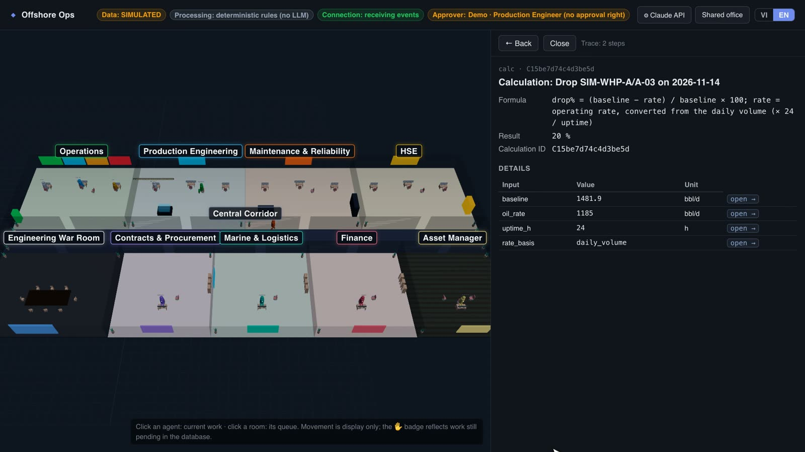

# Offshore Ops

**What if every department on an offshore asset had an AI agent that picked up its part of the job, and every conclusion it reached came with a receipt?**

Offshore Ops is an open-source prototype that turns a production drop into a coordinated, traceable workflow inside a live 3D office. Load the daily production reports and it flags the anomaly, opens a case, and hands the work to Production Engineering, Maintenance, HSE, Contracts, Logistics and Finance agents in dependency order. When data is missing, the step stops and asks for it instead of guessing. Click any finding to follow it back to the calculation, the exact data row and the source file's SHA-256. Approvals stay human: the wrong role is refused, and each decision is bound to the exact package version that was reviewed. RFQs stay drafts and vessel seats stay internal holds until a person says otherwise.

It runs locally on simulated data, with deterministic rules by default (Claude API optional), in English or Vietnamese. Clone it, start it, and watch the agents work the case. It's a prototype, so feedback is welcome: which coordination step costs your team the most time?



## Try it in five minutes

Requires **Node.js ≥ 22.13** (the workflow store uses the built-in `node:sqlite`).

```bash
git clone https://github.com/dinhduchuy/offshore-ops && cd offshore-ops
npm install
export OPS_HOME="$PWD/oilgas/en"     # English data set + English agent output; omit for the Vietnamese set
cd packages/app && npx next dev -p 3000
```

Open <http://localhost:3000/ops> and switch the top-right toggle to **EN**. Then:

1. **Data** → **Load base set (19 files)**. The DPR check finds the drop on well A-03, opens a case, and the agents start in their rooms.
2. **Workflow**. Production engineering stops on *Missing data*: the latest well test is too old. Go back to **Data** and **Load** the supplementary well test, and watch the flow continue to *Scope approval*.
3. Open **DPR intake, data checks & case triage** and click an evidence chip such as **E7**. Follow it to the calculation, then **open →** the DPR row, then the import with its SHA-256.
4. **Approvals** → **Scope approval** → **Record decision** as the default engineer. The server refuses. Pick *Demo · Head of Production Engineering* in the approver box and record the decision again.
5. **Outbox**: a draft RFQ waiting for approval to send, plus internal holds on budget, flight seats and vessel deck space. Nothing is sent or booked.

## What it is, and what it isn't

- **A prototype on simulated data.** Every data set is labelled SIMULATED; thresholds and the authority matrix are sample configuration in `oilgas/*/ops-config.json`.
- **Rules by default.** Agents run deterministic rules, and the top bar says so. A Claude API key can be added from **⚙ Claude API** for LLM-assisted reasoning; that is billed to your key and off until you configure it.
- **Demo identities, no SSO.** Approvers are picked from a demo directory. `OPS_OPERATING_MODE=production` blocks approvals until enterprise sign-in exists.
- **Nothing leaves your machine.** There is no outbound adapter: approving an RFQ only records the approval.
- **Local state.** The workflow database is `~/.diorama/ops.db` (override with `OPS_DB_PATH`).

Operator guide (Vietnamese): [oilgas/OPS_GUIDE.md](oilgas/OPS_GUIDE.md) · n8n / data integration: [oilgas/README.md](oilgas/README.md)

## Credits and sources

**Built on Diorama.** Offshore Ops is a derivative of **[Diorama](https://github.com/hitesh153/diorama-builder)** by **Hitesh Goyal**, released under the MIT License. Diorama is a general-purpose tool, not an oil and gas product: it lets developers build a 3D office for their AI coding agents (Claude Code, Codex CLI, OpenClaw gateways or any HTTP source) and watch them work. Everything offshore-specific in this repository was added on top of it: the workflow, the department agents, the approval and traceability model, the offshore layout and the simulated data. Hitesh Goyal is not involved in Offshore Ops, and nothing here implies his endorsement.

This repository starts from Diorama commit `98ebc60` (2026-07-07) and keeps its full commit history. The original copyright notice is in [LICENSE](LICENSE); keep it in any copy or fork.

| Reused from Diorama (general-purpose, extended here) | New in Offshore Ops (offshore-specific) |
|---|---|
| 3D engine: room layout, door graph, BFS pathfinding, room matching | `packages/ops`: SQLite store, data intake, anomaly detection, case workflow, department agents, approval gates, traceability |
| Event hub + SSE stream that drives the 3D world | `/ops` page: workflow board, task inspector, trace viewer, approvals, data, outbox, log |
| Live 3D view: walking agents, ✋ badge, activity feed | 10-room offshore layout (`templates/oil-gas-ops`, generated by `oilgas/generate_ops_layout.py`) |
| Copilot LLM adapters (Anthropic, OpenAI-compatible, Ollama, local CLIs) | LLM guard and untrusted-document handling, VI/EN interface layer, simulated data sets |

**3D furniture models.** [Kenney Furniture Kit](https://kenney.nl/assets/furniture-kit) by Kenney, licensed [CC0 1.0](https://creativecommons.org/publicdomain/zero/1.0/) (public domain). They came with Diorama, in `packages/app/public/models/kenney-furniture`.

**Open-source libraries.** At runtime: [Three.js](https://github.com/mrdoob/three.js), [React Three Fiber](https://github.com/pmndrs/react-three-fiber), [drei](https://github.com/pmndrs/drei), [Next.js](https://github.com/vercel/next.js), [React](https://github.com/facebook/react), [Zod](https://github.com/colinhacks/zod), [read-excel-file](https://gitlab.com/catamphetamine/read-excel-file), [unpdf](https://github.com/unjs/unpdf) and [ws](https://github.com/websockets/ws), all MIT. See `package-lock.json` for the complete list with exact versions.

**Data.** Every data set is SIMULATED and generated by scripts in this repository: `oilgas/sample-data/generate_sample_data.py` (Vietnamese test set, with deliberate data-quality faults) and `oilgas/en/generate_demo_data.py` (English demo set). Platform, well, vessel, flight, contract and supplier codes are fictional. Thresholds, gates and the authority matrix in `ops-config.json` are sample configuration, not any company's policy or standard. Industry terms (DPR, PTW, AFE, PSC, SIMOPS, RFQ) are used in their general sense.

**AI assistance.** Much of the Offshore Ops code and documentation was written with [Claude Code](https://claude.com/claude-code) (Anthropic) under the author's direction; the commits record this as co-authorship.

Offshore Ops itself is released under the same MIT License.

---

# Diorama, the engine underneath

*The rest of this README is Diorama's own documentation: the general-purpose 3D agent-world tool Offshore Ops is built on. These features work for any agents, not only offshore ones.*

**Build 3D worlds for your AI agents.** Design an office in a CAD-style
editor (or ask the AI copilot to design it for you), connect the agent
runtimes you already use, and watch your agents live — walking between
rooms, showing what they're working on.

Works today with **Codex CLI**, **Claude Code**, **OpenClaw gateways**, and
**anything that can send an HTTP request**.

## Quick start (from source)

> Not yet on npm — run from a checkout. Requires **Node ≥ 22.13** (the offshore-ops workflow uses the built-in `node:sqlite`).

```bash
git clone https://github.com/dinhduchuy/offshore-ops && cd offshore-ops
npm install
cd packages/app && npx next dev -p 3456
```

Open http://localhost:3456 — with no config you land in the wizard:

1. **Connect** — Diorama scans your machine for agent runtimes (Codex
   sessions, Claude Code projects) and offers one-click connections, an
   OpenClaw gateway form, an HTTP push option, or demo data.
2. **Build Your Office** — CAD-style editor: 2D/3D views, click-to-place
   rooms with ghost preview, drag / 8-handle resize / multi-select /
   keyboard nudge, numeric inspector, furniture catalog, floor styles,
   themes, full undo/redo — plus the **✦ AI copilot** tab
   ([docs](docs/copilot.md)).
3. **Configure Agents** — seat assignment, room access, energy per agent.
4. **Launch** — config saved to `~/.diorama/config.json`; the live world
   starts.

## Connect anything

```bash
curl -X POST http://localhost:3456/api/ingest \
  -H 'content-type: application/json' \
  -d '{"v":1,"type":"task.started","agent":"my-agent","room":"Lab","label":"running tests"}'
```

The agent appears in the world and **walks to the Lab**. Full protocol +
connector guide: [docs/connectors.md](docs/connectors.md).

## The living world

- Agents auto-seat in chairs; events send them walking door-to-door
  (BFS pathfinding over the room graph)
- Activity icons above heads (💬 talking, 🔬 testing, 📡 sending, …) derived
  from event types — no mapping config needed
- Restless agents (energy slider) wander between their allowed rooms
- Rolling activity feed + room glow on events
- **Dashboard view** (toggle top-right): live agent tiles, activity stream,
  per-room event counts

## Room presets & themes

5 presets (meeting, workspace, private, social, lab) × 4 themes (Sci-Fi,
Modern Office, Cyberpunk, Minimal) — furniture and materials morph per
theme. Per-room custom colors and 5 procedural floor textures on top.

## Configuration

Everything lives in `~/.diorama/config.json` (or a project's
`diorama.config.json`):

```json
{
  "name": "My Agent Office",
  "sources": [{ "type": "claude-code" }, { "type": "codex" }, { "type": "ingest" }],
  "gateway": { "url": "", "token": "" },
  "view": "3d-office",
  "theme": "neon-dark",
  "rooms": [
    { "preset": "meeting", "position": [0, 0], "size": [4, 3], "label": "Strategy Room" },
    { "preset": "lab", "position": [4, 0], "size": [4, 4], "label": "Lab" }
  ],
  "agents": {
    "claude/my-app": { "desk": "lab-desk-1", "seat": "Lab::2", "allowedRooms": [], "energy": 0.7 }
  }
}
```

Environment variables (like `$OPENCLAW_TOKEN`) are resolved at runtime.

## Packages

| Package | Purpose |
|---------|---------|
| `@diorama/engine` | Pure core: config schema, event protocol, geometry, room graph + pathfinding, presets, seating, activity derivation |
| `@diorama/plugins` | Connectors (OpenClaw, Codex, Claude Code, JSONL tailer), themes, LLM provider adapters |
| `@diorama/ui` | Builder store (reducer + undo/redo), copilot tool surface |
| `@diorama/cli` | `diorama init` scaffolding + dev server with gateway proxy |
| `@diorama/app` | Next.js app: wizard, CAD editor, live 3D world, dashboard |

## Architecture

```
 Codex sessions ─┐  (jsonl tail)
 Claude Code ────┤                                    ┌─ 3D office view (R3F)
 HTTP pushes ────┼─▶ Event hub ─▶ SSE ─▶ EventBus ─▶ ├─ Dashboard view
 OpenClaw ws ────┘   (server)           (browser)     └─ Activity feed

 Copilot chat ─▶ /api/copilot/chat ─▶ your LLM (key stays server-side)
      │                                    │
      └──── tool calls ──▶ builder reducer ┘   (every AI edit = one undo)
```

Engine stays pure (no React); all rendering lives in `packages/app`; the
config file is the single source of truth.

## Development

```bash
npm test          # full suite (530+ tests; live-gateway tests need DIORAMA_LIVE_TESTS=1)
npm run lint      # eslint
npm run typecheck # tsc project references + app check
```

CI runs lint + typecheck + tests + build on Node 22.13 (minimum) and 24.

## License

MIT. Original Diorama © 2026 Hitesh Goyal; see [LICENSE](LICENSE).
